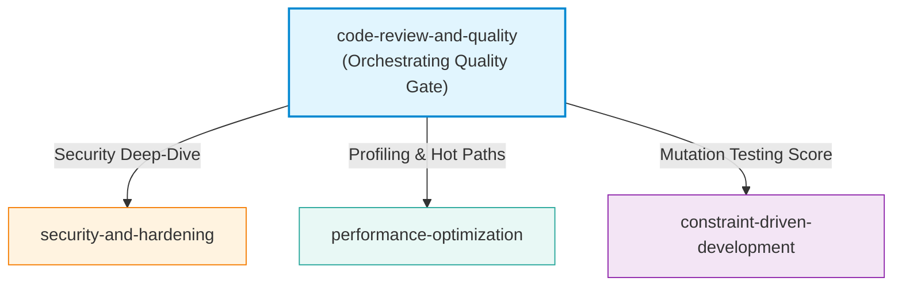

# Code Review & Quality Report

**Pull Request / Change:** PR #42 (`fix/customer-search-whitespace-normalization` → `main`)  
**Commit:** `756f1abd0b5e7a2c5f853bad9c3443d838aad32c`  
**Review Skill:** `code-review-and-quality`  
**Date:** 2026-10-08  
**Approval Standard:** Approve a change only when it definitely improves overall code health and adheres to project rules.

---

## 1. Executive Summary & Review Verdict

- **Review Verdict:** **REQUEST CHANGES** (Merge blocked until Critical and Required items are addressed).
- **Summary:** The proposed change enhances text normalization in customer search by collapsing consecutive whitespace characters (spaces, tabs, newlines) into a single space and reusing the normalization helper in match classification. While functionally intuitive, the change suffers from three primary issues:
  1. **Critical:** Tracking compiled Python bytecode files (`.pyc`) in git version control.
  2. **Required:** Introducing an undocumented business requirement (internal whitespace collapsing) not defined in `REQUIREMENTS.md` or `SPEC.md`, violating project governance rules (`AGENTS.md`).
  3. **Required:** Incomplete helper refactoring where `customer_sort_key` still uses raw un-collapsed string stripping rather than the canonical `normalize_text` helper.

---

## 2. Review Context & Input Baselines

### Referenced Documentation
- `REQUIREMENTS.md`: User story, functional requirements FR-01 through FR-08, NFR-01 through NFR-03, and constraints C-01 through C-03.
- `SPEC.md`: Detailed functional specifications SR-01 through SR-11, validation rules VR-01 through VR-04, error handling EH-01 through EH-04, and acceptance criteria AC-01 through AC-11.
- `ARCHITECTURE.md`: Layering, component responsibilities (CLI, Search Service, Data Loader, Customer Model), interfaces, and non-functional guarantees.
- `AGENTS.md`: Mandatory engineering rules ("Do not invent or add business requirements", "Keep implementation consistent with REQUIREMENTS.md, SPEC.md, and ARCHITECTURE.md").
- `TASKS.md`: Feature tasks T-01 through T-09.

### Scope of the Change
The PR touches 4 files (117 additions, 5 deletions):
- `src/customer_search/search_service.py`: 12 modified lines (updating `normalize_text` and `classify_match`).
- `tests/test_search_matching.py`: 110 added lines (6 new unit tests).
- `src/customer_search/__pycache__/search_service.cpython-314.pyc`: Binary bytecode modification (accidental commit).
- `tests/__pycache__/test_search_matching.cpython-314-pytest-9.1.1.pyc`: Binary bytecode modification (accidental commit).

---

## 3. Change Sizing & Description Discipline

### Change Sizing Evaluation
- **Lines changed:** ~122 lines of text and test code (+117, -5). Target in `code-review-and-quality` is `~100 lines changed` (Good, reviewable in one sitting).
- **File size impact:** `src/customer_search/search_service.py` grew to 276 lines total, well beneath the healthy boundary of ~1,000 lines.
- **Single logical change:** Yes, the change focuses narrowly on whitespace normalization in search queries and fields.

### Change Description Assessment
- **Commit subject:** `Enhance customer search normalization by collapsing whitespace and updating tests`
  - *Evaluation:* Short, imperative, and standalone. Satisfies the first-line guideline.
- **Commit body:** *Omitted / Empty.*
  - *Evaluation:* Lacks context explaining the rationale, intended customer benefit, and does not disclose the inclusion of compiled binary files.

---

## 4. Test Evidence & Mutation Analysis (Tests First)

### Automated Test Suite Execution
- **Environment:** Python 3.14.3, pytest 9.1.1, Windows x64.
- **Suite Status:** `88 passed in 1.05s` (100% pass rate).
- **Existing suite:** 73/73 customer search functional tests continue to pass without regressions.
- **New tests added:**
  - `test_normalize_text_collapses_whitespace`: Tests whitespace collapsing (multi-space, tabs, newlines, empty).
  - `test_exact_search_by_full_name_with_multiple_spaces`: Tests exact match with consecutive spaces.
  - `test_exact_search_by_full_name_with_tabs`: Tests exact match with tabs and mixed whitespace.
  - `test_partial_search_by_full_name_with_multiple_spaces`: Tests partial substring match with multiple spaces.
  - `test_normal_searches_continue_to_function`: Regression guard for normal names, partials, and emails.
  - `test_empty_or_whitespace_queries_preserve_existing_behavior`: Ensures empty/whitespace queries still reject properly.

### Mutation Coverage Analysis
- **Mutation experiment:** Reverting `normalize_text` from `" ".join(text.split()).lower()` back to `text.strip().lower()` causes 5 newly added tests to fail immediately (`test_normalize_text_collapses_whitespace`, `test_exact_search_by_full_name_with_multiple_spaces`, `test_exact_search_by_full_name_with_tabs`, `test_partial_search_by_full_name_with_multiple_spaces`, and `test_classify_match_function`). This confirms the added tests are actively killing regressions on search matching.
- **Identified Test Gap:** The test suite does not verify customer records whose raw stored fields (in JSON) contain multiple internal spaces, nor does it test alphabetical tie-break sorting when customer names contain internal spaces (testing `customer_sort_key`).

---

## 5. Five-Axis Code Review

### Axis 1: Correctness
- **Matching & Logic:** The expression `" ".join(text.split()).lower()` correctly strips outer whitespace, converts to lowercase, and collapses arbitrary sequences of whitespace characters (spaces, `\t`, `\n`) into a single space.
- **Boundary Handling:** When given empty or whitespace-only input, `text.split()` evaluates to `[]`, returning `""`. Downstream validation in `validate_search_term()` continues to intercept empty and whitespace-only queries via `query.strip()`, correctly preserving `VR-02`, `VR-03`, `EH-01`, and `EH-02`.
- **Specification Divergence:** `REQUIREMENTS.md` (FR-03) and `SPEC.md` (SR-04) explicitly specify *case-insensitive* comparison. Neither document defines internal whitespace collapsing. Implementing behavior beyond the spec violates `AGENTS.md` rules against inventing requirements.

### Axis 2: Readability & Simplicity
- **Simplicity:** The implementation is concise and Pythonic (1 line of code for normalization). No convoluted regular expressions or manual character traversals are used.
- **Naming & Docstrings:** `normalize_text` has an updated docstring explaining the behavior.
- **Internal Inconsistency:** In the same module, `customer_sort_key` uses `.strip().lower()` rather than `normalize_text()`, creating diverging normalization logic within the same service.

### Axis 3: Architecture & Structural Health
- **Module Boundaries:** Clean. Search normalization logic remains encapsulated within `search_service.py`. No domain leaks into `customer.py` or `data_loader.py`.
- **Structural Remedy Applied by PR:** `classify_match` previously duplicated `.strip().lower()` inline across 4 fields. The PR successfully applied the remedy *"Reuse the canonical helper instead of a bespoke near-duplicate"* for `classify_match`.
- **Structural Remedy Missed by PR:** `customer_sort_key` was missed during this consolidation and continues using the bespoke near-duplicate.
- **Repository Hygiene:** The presence of tracked `.pyc` files in git violates repository architecture and clean build isolation.

### Axis 4: Security
- **Untrusted Input:** The search query originates from untrusted CLI input. `str.split()` and `str.join()` operate safely in-memory without risk of command injection, SQL injection, or format string exploits.
- **Resource Exhaustion:** For standard inputs, memory allocation is trivial. For extreme input strings (e.g. hundreds of megabytes), `str.split()` allocates token lists. In a local CLI utility, this is acceptable, but boundary validation should cap maximum query length if exposed beyond local CLI.
- **Data Protection:** No credentials or customer PII are leaked to logs or external targets.

### Axis 5: Performance
- **Hot-Path Allocations:** In `classify_match`, `normalize_text` is invoked 4 times per customer. In a dataset of 10,000 customers (NFR-02), this triggers 40,000 string splits and joins.
- **Redundant Traversal:** `SearchService.search()` calls `get_exact_matches()` and `get_partial_matches()`, each calling `find_matches()` independently. This traverses the 10,000 customer list *twice*, doubling calls to `classify_match` to 80,000 per search. While execution time remains well below NFR-01 (< 2.0s locally), this redundant computation is an unnecessary performance penalty.

---

## 6. Detailed Findings

### Finding 1: Tracked Compiled Bytecode Artifacts in Git
- **Severity:** `Critical:` (Blocks merge)
- **File / Evidence:**
  - `src/customer_search/__pycache__/search_service.cpython-314.pyc`
  - `tests/__pycache__/test_search_matching.cpython-314-pytest-9.1.1.pyc`
  (Modified in commit `756f1abd0b5e7a2c5f853bad9c3443d838aad32c`)
- **Engineering Rationale:**
  Compiled Python bytecode files are machine-generated build artifacts tied to a specific Python runtime (Python 3.14.3). Checking binary artifacts into source control causes git repository bloat, produces merge conflicts across team members with different Python patch versions or operating systems, and violates repository hygiene standards.
- **Recommended Action:**
  1. Remove tracked bytecode from the git index:
     ```bash
     git rm --cached -r src/**/__pycache__ tests/**/__pycache__
     ```
  2. Add a root `.gitignore` file ignoring bytecode and test cache artifacts (`__pycache__/`, `*.pyc`, `.pytest_cache/`, `.coverage`).

---

### Finding 2: Specification Divergence & Undocumented Requirement
- **Severity:** `Required:` (Must address before merge)
- **File / Evidence:**
  - `src/customer_search/search_service.py:65-73` (`normalize_text`)
  - `REQUIREMENTS.md` (FR-03)
  - `SPEC.md` (SR-04, AC-04)
  - `AGENTS.md` ("Project Rules")
- **Engineering Rationale:**
  `normalize_text` introduces internal whitespace collapsing (`" ".join(text.split()).lower()`). However, `REQUIREMENTS.md` (FR-03) and `SPEC.md` (SR-04) specify normalization strictly as case-insensitive matching:
  > *"SR-04 — Case Insensitivity: Search comparison shall be case-insensitive. The search string and searchable customer values shall be normalized before comparison."*
  
  Neither document states that multiple consecutive spaces, tabs, or newlines must be collapsed into a single space. Introducing behavioral logic without updating specification artifacts violates `AGENTS.md` ("Do not invent or add business requirements", "Keep implementation consistent with REQUIREMENTS.md, SPEC.md, and ARCHITECTURE.md").
- **Recommended Action:**
  Escalate to the product owner / team for an explicit specification decision:
  - **Option A (Adopt):** Formally update `REQUIREMENTS.md` (FR-03) and `SPEC.md` (SR-04, AC-04) to specify whitespace collapsing as a normative requirement.
  - **Option B (Reject):** Revert `normalize_text` to `text.strip().lower()`.

---

### Finding 3: Inconsistent Normalization Helper Reuse in Sort Key
- **Severity:** `Required:` (Structural Remedy: Reuse canonical helper)
- **File / Evidence:**
  - `src/customer_search/search_service.py:96-106` (`customer_sort_key`)
  - `src/customer_search/search_service.py:129-136` (`classify_match`)
- **Engineering Rationale:**
  While the PR appropriately refactored `classify_match` to reuse `normalize_text` across all 4 customer fields, `customer_sort_key` in the exact same file continues to use raw inline string stripping:
  ```python
  def customer_sort_key(customer: Customer) -> tuple[str, str, str]:
      return (
          customer.name.strip().lower(),
          customer.surname.strip().lower(),
          customer.email.strip().lower(),
      )
  ```
  This violates the structural guideline: *"Reuse the canonical helper instead of a bespoke near-duplicate."* If customer records contain internal whitespace variations, search matching and alphabetical tie-break sorting will apply diverging normalization rules.
- **Recommended Action:**
  Update `customer_sort_key` to use `normalize_text`:
  ```python
  def customer_sort_key(customer: Customer) -> tuple[str, str, str]:
      return (
          normalize_text(customer.name),
          normalize_text(customer.surname),
          normalize_text(customer.email),
      )
  ```
  Add a unit test in `tests/test_ordering_and_limit.py` verifying that alphabetical sorting handles names with irregular internal spaces consistently.

---

### Finding 4: Redundant Dataset Traversal and String Allocations in Search Loop
- **Severity:** `Optional:` / `Consider:` (Structural Remedy: Single-pass partitioning)
- **File / Evidence:**
  - `src/customer_search/search_service.py:183-213` (`search`, `get_exact_matches`, `get_partial_matches`)
- **Engineering Rationale:**
  `SearchService.search()` executes:
  ```python
  exact_sorted = self.get_exact_matches(query)
  partial_sorted = self.get_partial_matches(query)
  ```
  Both helpers invoke `self.find_matches(query)` independently. As a result, the entire customer collection (up to 10,000 items) is traversed twice, calling `classify_match` 20,000 times instead of 10,000 times. With whitespace collapsing now performing `.split()` and `.join()` on 4 fields per record, this introduces 40,000 redundant string allocations in the hot search path.
- **Recommended Action:**
  Partition matches in a single pass over `find_matches(query)`:
  ```python
  def search(self, query: str, limit: int = MAX_RESULTS) -> list[Customer]:
      exact: list[Customer] = []
      partial: list[Customer] = []
      for match in self.find_matches(query):
          if match.match_type == MatchType.EXACT:
              exact.append(match.customer)
          elif match.match_type == MatchType.PARTIAL:
              partial.append(match.customer)

      exact_sorted = sorted(exact, key=customer_sort_key)
      partial_sorted = sorted(partial, key=customer_sort_key)
      return (exact_sorted + partial_sorted)[:limit]
  ```

---

### Finding 5: Commit Description Lacks Context and Rationale
- **Severity:** `Nit:` (Formatting / Commit Hygiene)
- **File / Evidence:**
  - Commit `756f1abd0b5e7a2c5f853bad9c3443d838aad32c` message
- **Engineering Rationale:**
  The commit description contains only a subject line without a body explaining why the change was made, what issue it addresses, or why whitespace collapsing was adopted.
- **Recommended Action:**
  When squashing or merging the branch, supply a complete commit body linking to relevant task tracking and explaining the behavioral motivation.

---

### Finding 6: Upstream Input Boundary Enforcement
- **Severity:** `FYI` (Defensive Architecture)
- **File / Evidence:**
  - `src/customer_search/search_service.py:75-93` (`validate_search_term`)
- **Engineering Rationale:**
  `validate_search_term` verifies non-emptiness, but does not impose a maximum query length limit. While safe for CLI usage, if this service is later integrated into a web API, unbounded input could lead to high CPU/memory consumption in `text.split()`.
- **Recommended Action:**
  Consider establishing a maximum search term length (e.g. 256 characters) during future API integration phases.

---

## 7. Skill Composition (Composición de Skills)

The `code-review-and-quality` skill acts as an overarching quality gate that reviews across multiple dimensions and explicitly defines compositions with specialized downstream skills:



### Documented Skill Compositions:
1. **Composition with `security-and-hardening`:**
   - *Trigger / Rationale:* Referenced by Axis 4 for comprehensive vulnerability scanning, untrusted input boundary enforcement, and dependency audits (`npm audit` / `pip-audit`).
   - *Application to this change:* While the present CLI change is low risk, if the search service is expanded to multi-tenant or network services, `security-and-hardening` should be engaged to validate maximum input length boundaries and sanitize unexpected control characters.
2. **Composition with `performance-optimization`:**
   - *Trigger / Rationale:* Referenced by Axis 5 for profiling bottlenecks, memory allocations, and query optimization.
   - *Application to this change:* Applicable to the NFR-02 scale test (10,000 customers). If dataset sizes exceed 10,000 records, `performance-optimization` can guide pre-normalizing customer records upon loading (e.g., storing a normalized search tuple on `Customer`) to avoid re-evaluating `normalize_text` repeatedly.
3. **Composition with `constraint-driven-development`:**
   - *Trigger / Rationale:* Referenced by Step 2 for automated repository-wide mutation testing scores.
   - *Application to this change:* Measures test robustness across condition mutations (such as replacing `==` with `in` or altering match type precedence).

*(Note: In accordance with review instructions, executing these secondary skills was not required for this review turn).*

---

## 8. Dead Code & Dependency Discipline

- **Dead Code Hygiene:** Zero dead code or orphaned shims were introduced. All replaced lines in `search_service.py` were fully substituted by active logic.
- **Dependency Discipline:** No new external dependencies or packages were introduced. The implementation strictly adheres to constraints `C-01` and `C-03` (standard library Python + pytest only).

---

## 9. The Review Checklist

| Area | Check Item | Status | Notes |
|---|---|---|---|
| **Context** | I understand what this change does and why | [x] Yes | Whitespace collapsing enhancement |
| **Correctness** | Change matches spec/task requirements | [ ] No | Diverges from `SPEC.md` SR-04 / `REQUIREMENTS.md` FR-03 |
| | Edge cases handled | [x] Yes | Empty, mixed whitespace, tabs handled |
| | Error paths handled | [x] Yes | Input validation preserved |
| | Tests cover the change adequately | [x] Yes | 6 new tests added; sort key gap noted |
| **Readability** | Names are clear and consistent | [x] Yes | Helper name and variables clear |
| | Logic is straightforward | [x] Yes | Pythonic split/join pattern |
| | No unnecessary complexity | [x] Yes | Minimal line footprint |
| **Architecture** | Follows existing patterns | [ ] No | `customer_sort_key` not updated to use canonical helper |
| | Clean module boundaries | [x] Yes | Search service owns logic |
| | Repository hygiene | [ ] No | Tracked `.pyc` files in git |
| | Refactor reduces complexity | [x] Yes | Simplifies field comparisons |
| **Security** | No secrets in code | [x] Yes | Clean |
| | Input validated at boundaries | [x] Yes | `validate_search_term` intact |
| | No injection vulnerabilities | [x] Yes | Safe string operations |
| **Performance** | No unbounded operations | [x] Yes | Capped by customer count |
| | No redundant data traversals | [ ] No | Redundant pass in `search()` |
| **Verification** | Tests pass | [x] Yes | 88/88 passed in 1.05s |
| | Build succeeds | [x] Yes | Clean test execution |
| **Verdict** | **Approve** / **Request changes** | **Request changes** | Address Critical and Required findings |

---

## 10. Summary of Required Actions for Author

To proceed with merging PR #42, the author must complete the following:

1. **Remove `.pyc` files:** Untrack all compiled bytecode files from git index and add a `.gitignore`.
2. **Align Specification:** Escalate whitespace collapsing behavior to the product owner; update `REQUIREMENTS.md` and `SPEC.md` if accepted, or revert to `text.strip().lower()` if rejected.
3. **Harmonize Sort Key:** Refactor `customer_sort_key` to use `normalize_text` for uniform sorting and search behavior.
4. *(Recommended)* Single-pass partition in `search()` to eliminate redundant scans over customer records.
